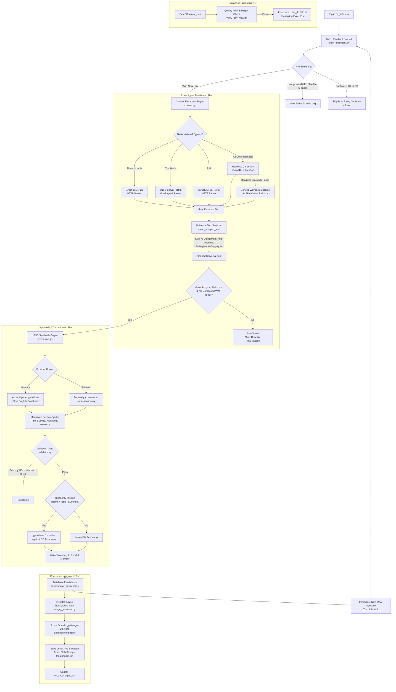

# UPSC Current Affairs Ingestion & Synthesis Pipeline

An enterprise-grade, local pipeline designed to ingest news articles from Excel spreadsheets, crawl content bypassing bot-detection blocks and paywalls, sanitize content universally, synthesize high-yield UPSC Civil Services examination coaching notes, automatically classify topics against syllabus taxonomies, generate high-resolution editorial infographics asynchronously, and store validated records across database tiers (`mntor_dev` ➔ `pilot_db` / `prod`).

---

## 1. System Architecture Overview

The system is designed as a modular, decoupled Python architecture optimized for high-throughput batch processing, zero idle wait time, universal content sanitization, and strict data quality gates.

```
yooki/
├── current_affairs/                   # Core modular package
│   ├── __init__.py                    # Public API exports
│   ├── config.py                      # Environment variables, model endpoints, project paths
│   ├── database.py                    # SQLAlchemy Models & Session Factory
│   ├── crawler.py                     # Generic Crawl4AI engine, direct bypass extractors & universal sanitizer
│   ├── synthesizer.py                 # Azure OpenAI primary & Perplexity fallback synthesis engine
│   ├── classifier.py                  # gpt-6-luna taxonomy classification (mtr_subjects/topics/subtopics)
│   ├── image_generator.py             # Azure OpenAI (gpt-image-2.5-flare) infographic generation & Blob upload
│   ├── validator.py                   # Data quality verification & dummy content guards
│   ├── pipeline.py                    # Single article end-to-end orchestration service
│   └── excel_processor.py             # Batch Excel reader, concurrent image tasks, bulk job tracking
├── logs/                              # Audit logs (ca_status_log_<timestamp>.csv, ca_status_log_latest.csv)
├── generated_images/                  # Local cache of generated editorial infographics ({id}.jpg)
├── ca_local_main.py                   # CLI entrypoint for batch processing
├── load_to_pilot_db.py                # Database migration & promotion script (mntor_dev -> pilot_db)
├── pyproject.toml                     # Dependency definitions (managed via uv)
├── .env                               # Centralized credentials, model deployments, and system settings
└── README.md                          # Architectural & operational documentation
```

---

## 2. End-to-End Pipeline Architecture



---

## 3. Subsystem Breakdown

### 1. Ingestion & Pre-Screening (`excel_processor.py`, `ca_local_main.py`)
- **Excel Ingestion**: Loads `.xlsx` spreadsheets, dynamically maps columns (`article_url`, `theme`, `topic`, `subtopic`, `date`), and creates a unique tracking job in `mtr_ca_bulk_jobs`.
- **Pre-Crawl Duplicate Guard**: Queries `mtr_current_affairs_edk` by canonicalized URL. If already present, skips processing in **< 1s** and records the existing article ID.
- **Unsupported Link Filter**: Detects non-article links (e-paper viewers, video files, direct PDFs, audio streams) and halts early to prevent wasted browser overhead.

### 2. Web Crawling & Universal Sanitization (`crawler.py`)
- **Targeted Network-Level Bypasses**:
  - **Times of India (TOI)**: Direct server-side JSON-LD extraction (`extract_toi_direct`) without browser launch.
  - **The Hindu**: Direct HTTP server-side HTML parser (`extract_thehindu_direct`) fetching full articles before client-side paywall JavaScript executes.
  - **PIB**: Direct HTTP scraper for Press Information Bureau releases, press notes, and factsheets (`extract_pib_direct`).
- **Generic Headless Chromium (`Crawl4AI`)**:
  - Used for standard news sites (LiveMint, Indian Express, BBC, IDSA, DownToEarth, etc.).
  - Employs anti-bot bypass parameters, BM25 content filtering, dynamic scrolling, and overlay removal.
- **Universal Text Sanitizer (`clean_scraped_text`)**:
  - Strips AI auto-translation banners (Devanagari/English notices, e.g. Indian Express translation widgets).
  - Removes publisher app download promotions, newsletter prompts, and social media links.
  - Removes syndication footers, "Also Read" prefixes, and copyright notices universally from **any** crawled content.
- **Generic Wayback Machine Fallback (`fetch_with_fallback`)**:
  - Automatically queries the Internet Archive Wayback endpoint when live crawls fail for any domain.
- **Safe WAF Detection**:
  - Uses regex word boundaries (`\bwaf\b`) and compound phrases (`cloudflare waf`, `aws waf`) to prevent false-positive blocks on semiconductor "wafer" articles.
- **Strict Fail-Closed Policy**:
  - Rejects any crawl with `< 300` characters or verified block indicators.
  - Guarantees **no synthetic hallucinations or images are ever generated for missing/blocked content**.

### 3. Synthesis & Markdown Parsing (`synthesizer.py`)
- **Dual-Provider Architecture**:
  - **Primary**: Azure OpenAI **`gpt-6-luna`** for consistent, fast synthesis.
  - **Fallback**: Perplexity AI **`sonar-pro`** (with automatic fallback to `sonar-reasoning`).
- **Critical Language Constraint**:
  - Enforces `CRITICAL LANGUAGE CONSTRAINT: All generated outputs must strictly and exclusively be in English.` in the system prompt. Even if source text contains vernacular snippets, output notes are 100% English.
- **Strict UPSC Formatting**:
  - Generates level-5 markdown headers (`#####`).
  - Standardized GS paper tag: `<span class="evaluation-result-card-but">GS II (Governance), GS III (Economy)</span>`.
  - Structured sections: *Key Takeaways*, *Historical Context & Relevant Data*, *Analysis & Implications*, *Way Forward*, and *Keywords*.
- **Resilient Markdown Section Splitter**:
  - Isolates Title, Subtitle (15–20 word summary), Highlights, and Keywords cleanly regardless of markdown header styling.

### 4. Syllabus Taxonomy Classification (`classifier.py`)
- Dynamically queries syllabus taxonomies from `mtr_subjects`, `mtr_topics`, and `mtr_subtopics`.
- When `theme_topic` or `theme_subtopic` is missing, sends synthesized metadata (title, subtitle, keywords) to **`gpt-6-luna`** to map the content to the official UPSC syllabus tree.
- Automatically writes back resolved classifications into the source Excel spreadsheet.

### 5. Asynchronous Infographic Generation (`image_generator.py`)
- **Parallel Non-Blocking Execution with Concurrency Throttling**: Once an article's notes and database records are staged (~8s), image generation is dispatched to a background queue governed by an `asyncio.Semaphore(1)`. This serializes requests to Azure OpenAI, completely preventing HTTP 429 rate-limit backoffs (which previously inflated elapsed times to 160+s).
- **Landscape Editorial Infographic**: Retains standard **`1536x1024`** landscape format (`AZURE_IMAGE_SIZE`) matching the card banners in the student UI without cropping top/bottom text or diagrams.
- **Detailed Sub-Step Telemetry**: Logs granular timing: AI generation, local JPEG optimization, and Azure Blob Storage upload.

### 6. Relational Persistence & Promotion (`database.py`, `load_to_pilot_db.py`)
- **Granular Timing Audit Logging**: Emits real-time link-by-link execution details to `logs/ca_status_log_<timestamp>.csv` (mirrored to `ca_status_log_latest.csv`) including individual step timing columns: `scrape_sec`, `synthesis_sec`, `taxonomy_sec`, `db_sec`, and `total_sec`.
- **Multi-Stage Promotion**: `load_to_pilot_db.py` audits `mntor_dev` with regex checks to ensure 0 corrupted/dummy records exist before promoting rows into `pilot_db` / `prod`, strictly preserving exact primary key IDs across all 4 tables.

---

## 4. Models & Providers in Use

| Capability | Model | Provider | Deployment / Env Config |
| :--- | :--- | :--- | :--- |
| **UPSC Notes Synthesis (Primary)** | **`gpt-6-luna`** | **Azure OpenAI** | `SYNTHESIS_PRIMARY_PROVIDER=azure`<br>`AZURE_SYNTHESIS_MODEL=gpt-6-luna` |
| **UPSC Notes Synthesis (Fallback)** | **`sonar-pro` / `sonar-reasoning`** | **Perplexity AI** | `PRIMARY_SYNTHESIS_MODEL=sonar-pro`<br>`FALLBACK_SYNTHESIS_MODEL=sonar-reasoning` |
| **Taxonomy Classification** | **`gpt-6-luna`** | **Azure OpenAI** | `MODEL_GENERATOR=gpt-6-luna` |
| **Infographic Image Generation** | **`gpt-image-2.5-flare`** | **Azure OpenAI** | `CA_GEN_AZURE_OPENAI_IMAGE_DEPLOYMENT=gpt-image-2.5-flare` |

---

## 5. Database Schema & Tables

The pipeline synchronizes four core tables per article across database environments (`mntor_dev`, `pilot_db`):

| Table | Primary Key | Key Attributes | Description |
| :--- | :--- | :--- | :--- |
| **`mtr_current_affairs_edk`** | `id` (INT) | `topic`, `content`, `theme`, `theme_topic`, `theme_subtopic`, `ca_created_date`, `created_at`, `source` | Core article metadata and 15–20 word summary (`content`). |
| **`mtr_ca_highlights_edk`** | `id` (INT) | `current_affair_id`, `highlight_text`, `created_at` | Full UPSC coaching notes formatted with level-5 markdown headers and GS badges. |
| **`mtr_ca_images_edk`** | `id` (INT) | `current_affair_id`, `image_url`, `created_at` | Azure Blob Storage CDN URL pointing to `thumbnail/{id}.jpg`. |
| **`mtr_ca_kword_edk`** | `id` (INT) | `current_affair_id`, `kword` | Comma-separated high-yield UPSC exam keywords. |
| **`mtr_ca_bulk_jobs`** | `id` (UUID) | `status`, `total_records`, `successful_records`, `failed_records`, `details` (JSON), `started_at`, `completed_at` | Batch job execution telemetry and row-by-row audit trails. |

---

## 6. CLI Usage & Operations

### 1. Run Local Ingestion Batch
Process the default spreadsheet (`ca_lists.xlsx`):
```bash
./.venv/bin/python ca_local_main.py ca_lists.xlsx
```

### 2. Promote Records from Dev to Pilot/Test
Verify quality and promote all new articles above a specific minimum ID:
```bash
./.venv/bin/python load_to_pilot_db.py --min-id 10108
```

### 3. Programmatic Invocation
```python
import asyncio
from current_affairs import process_excel_file, validate_article_for_db, get_db_session

# Run batch ingestion
asyncio.run(process_excel_file("ca_lists.xlsx"))

# Validate article quality in database
with get_db_session() as session:
    is_valid, issues = validate_article_for_db(article_id=10231, db=session)
    print(f"Article 10231 valid: {is_valid}, Issues: {issues}")
```
